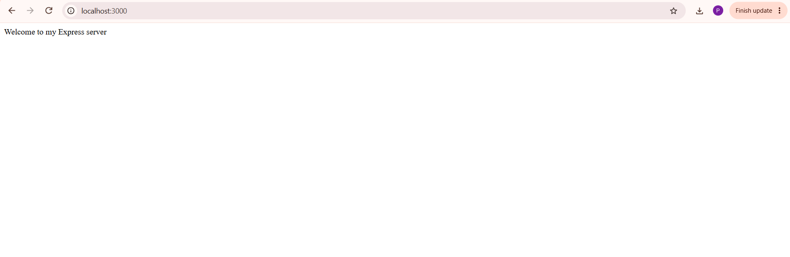
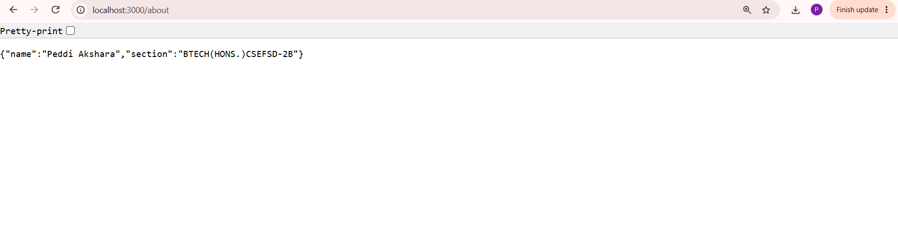
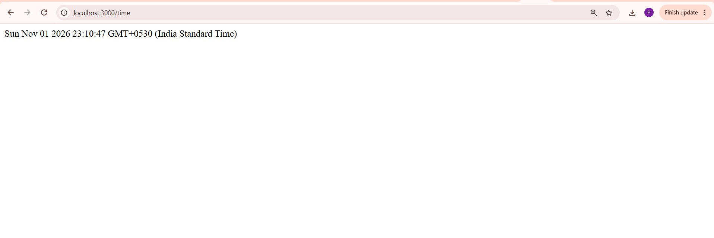
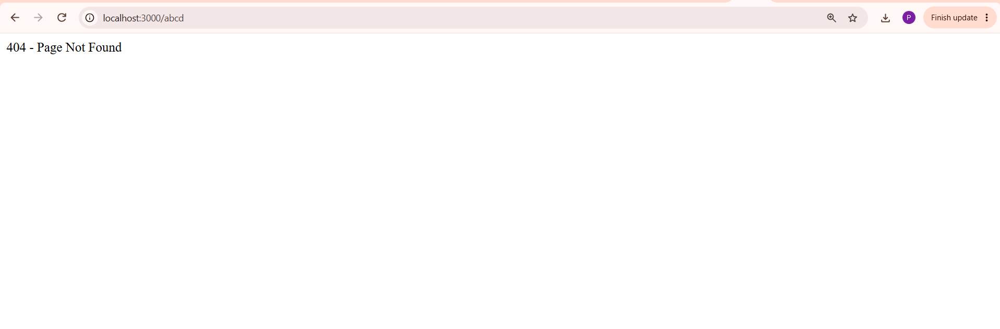

# Lab 1: Node.js and Express server

**Name:** Akshara  
**Registration number:** 252U1R7079  
**Section:** CSE(FSD)-2B  

## Live link
Not deployed yet. Run the project locally using the steps below. Add your deployed public URL here after deployment

## Objective
Set up a Node.js project and build a small web server using the built-in `http` module, then build the same server using Express.

## package.json fields
- `name`: Name of the project.
- `version`: Current project version.
- `description`: Short explanation of the project.
- `main`: Main entry JavaScript file.
- `scripts`: Commands used to run the project.
- `keywords`: Search terms related to the project.
- `author`: Project author.
- `license`: Project licence.
- `dependencies`: Packages required by the project, including Express.

## Installation
Make sure Node.js and npm are installed. Open a terminal in this folder and run:

```bash
npm install
```

## How to run

### Task 3 - Built-in HTTP server
```bash
npm run start:http
```
Open http://localhost:3000. It responds with `Hello`.

Stop the server with `Ctrl + C` before starting the Express server because both use port 3000.

### Tasks 4-7 - Express server
```bash
npm run start:express
```

Open these URLs in a browser:

| Method | Path | Description | Expected status |
|---|---|---|---|
| GET | `/` | Displays the welcome message | 200 |
| GET | `/about` | Displays name and section in JSON | 200 |
| GET | `/time` | Displays the current date and time in JSON | 200 |
| GET | `/unknown` | Displays the 404 message for an unknown path | 404 |

The terminal logs the HTTP method, requested path and returned status code for each request.

## Screenshots








## Notes: problems faced and how I solved them
- If `npm` commands do not work, check that Node.js is installed and restart the terminal.
- If port 3000 is already in use, stop the other server or close the program using that port.
- `node_modules` is created by `npm install` and should not be committed to GitHub.

## Viva preparation
**1. Difference between package.json and node_modules:**  
`package.json` stores project details, scripts and dependency information. `node_modules` contains the installed package files.

**2. What does app.listen do?**  
It starts the Express server and makes it listen for requests on the specified port.

**3. What do request and response represent?**  
The request (`req`) contains information sent by the client. The response (`res`) is used by the server to send data and a status code back to the client.
